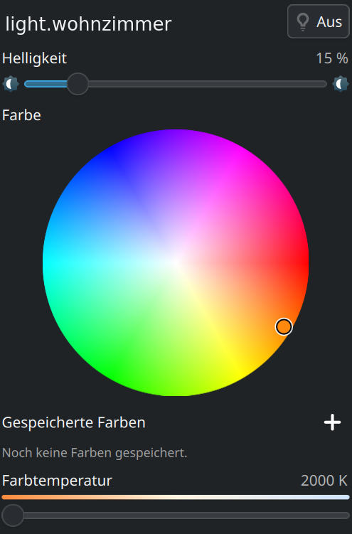
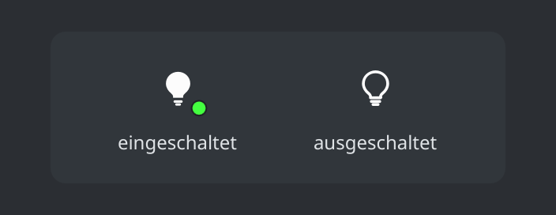

# Plasma Light Control

Ein KDE-Plasma-6-Panel-Widget (Plasmoid), das eine über
[Home Assistant](https://www.home-assistant.io/) angebundene Lampe steuert:
An/Aus, Helligkeit, Farbe (über einen HSV-Farbkreis), Farbtemperatur sowie
gespeicherte Lieblingsfarben.

## Vorschau

<p align="center">
  
</p>

Eigene, an die Theme-Farbe angepasste Panel-Icons zeigen den Zustand der Lampe
(eingeschaltet mit Farbpunkt für die aktuelle Lichtfarbe, ausgeschaltet):

<p align="center">
  
</p>

## Funktionen

- **Panel-Icon**
  - *Linksklick* – öffnet/schließt das Bedienfenster
  - *Mittelklick* – schaltet die Lampe direkt an/aus (Toggle)
  - *Mausrad* – regelt die Helligkeit
  - Farbpunkt am Icon zeigt die aktuelle Lichtfarbe, ein rotes Warnzeichen
    signalisiert eine fehlende Verbindung
- **Bedienfenster**
  - Großer An/Aus-Schalter
  - Helligkeits-Slider
  - HSV-Farbkreis (Winkel = Farbton, Radius = Sättigung)
  - Gespeicherte Farben: aktuelle Farbe mit „+" sichern, per Klick anwenden,
    per Rechtsklick löschen
  - Farbtemperatur-Slider (warm ↔ kalt), sofern die Lampe das unterstützt
- **Einstellungen**: URL, Access Token, Entity-ID und Abfrageintervall,
  inklusive „Verbindung testen"-Knopf

Farb- und Temperaturregler werden automatisch nur angezeigt, wenn die Lampe
die jeweiligen `supported_color_modes` meldet.

## Voraussetzungen

- KDE Plasma 6 (getestet mit 6.7)
- Eine erreichbare Home-Assistant-Instanz
- Ein **Long-Lived Access Token** (Home Assistant → *Profil → Sicherheit →
  Long-Lived Access Tokens*)

## Installation

```sh
./install.sh
```

oder manuell:

```sh
kpackagetool6 --type Plasma/Applet --install package    # Erstinstallation
kpackagetool6 --type Plasma/Applet --upgrade package     # Aktualisierung
```

Danach das Widget über „Zur Kontrollleiste hinzufügen" bzw. in den
Miniprogramme-Dialog aus dem Panel-Kontextmenü einfügen.

## Konfiguration

1. Rechtsklick auf das Widget → **Plasma Light Control einrichten…**
2. **Home-Assistant-URL** eintragen, z. B. `http://homeassistant.local:8123`
3. **Access Token** einfügen
4. **Entity-ID** der Lampe angeben, z. B. `light.wohnzimmer`
5. Mit **Verbindung testen** prüfen

## Deinstallation

```sh
kpackagetool6 --type Plasma/Applet --remove com.github.danzicchi.plasmalightcontrol
```

## Projektstruktur

```
package/
├── metadata.json                 Paket-Metadaten
└── contents/
    ├── config/
    │   ├── main.xml              Konfigurationsschlüssel
    │   └── config.qml           Einstellungskategorien
    └── ui/
        ├── main.qml             Zustand, Polling, HA-Aktionen
        ├── CompactRepresentation.qml   Panel-Icon (Klick/Mittelklick/Rad)
        ├── FullRepresentation.qml      Bedienfenster
        ├── ColorWheel.qml       HSV-Farbkreis (Canvas)
        ├── ConfigGeneral.qml    Einstellungsseite
        └── HomeAssistant.js     REST-API-Anbindung
```
