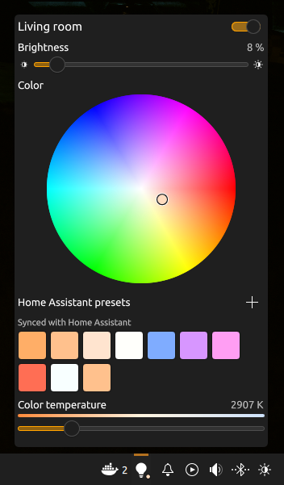

# Plasma Light Control

A KDE Plasma 6 panel widget (plasmoid) that controls a lamp exposed through
[Home Assistant](https://www.home-assistant.io/): on/off, brightness, color
(with an HSV color wheel), color temperature, and color presets (stored
locally or synchronized with Home Assistant).

## Preview

<p align="center">
  
</p>

## Features

- **Panel icon**
  - *Left click* – opens/closes the popup
  - *Middle click* – toggles the lamp directly
  - *Mouse wheel* – adjusts brightness
  - The dot on the icon shows the current light color, a red warning sign
    signals a missing connection
- **Popup**
  - Large on/off switch
  - Brightness slider
  - HSV color wheel (angle = hue, radius = saturation)
  - Presets: save the current color with "+", apply with a click, delete
    with a right click (local or synchronized)
  - Color temperature slider (warm ↔ cold) when the lamp supports it
- **Settings**: URL, access token, entity ID and polling interval, including
  a **Test connection** button

The color and temperature controls are shown only when the lamp reports the
corresponding `supported_color_modes`.

## Requirements

- KDE Plasma 6 (tested with 6.7)
- A reachable Home Assistant instance
- A **Long-Lived Access Token** (Home Assistant → *Profile → Security →
  Long-Lived Access Tokens*)

## Installation

Download the `.plasmoid` file from the latest
[release](https://github.com/danzicchi/PlasmaLightControl/releases) and install
it with:

```sh
kpackagetool6 --type Plasma/Applet --install plasmalightcontrol-vX.Y.plasmoid
```

From a source checkout, `install.sh` builds the modules, then installs or
updates the package:

```sh
./install.sh
```

or through pnpm:

```sh
pnpm run install:widget
```

Manual install from a checkout needs a build first:

```sh
pnpm install && pnpm run build
kpackagetool6 --type Plasma/Applet --install package    # first install
kpackagetool6 --type Plasma/Applet --upgrade package     # update
```

Then add the widget from the panel context menu (*Add Widgets*), or through
the widget dialog of the panel.

## Configuration

1. Right-click the widget → **Configure Plasma Light Control…**
2. Enter the **Home Assistant URL**, e.g. `http://homeassistant.local:8123`
3. Paste the **Access token**
4. Enter the lamp's **Entity ID**, e.g. `light.living_room`
5. Check the connection with **Test connection**

## Uninstallation

```sh
kpackagetool6 --type Plasma/Applet --remove com.github.danzicchi.plasmalightcontrol
```

## Development

All logic lives in `src/` (TypeScript) and is built into
`package/contents/ui/generated/`. The QML files are hosts: they declare only
the objects that exist in QML (WebSocket, Timer, Loader, Canvas, configuration
aliases) and forward calls to the modules (`panel/session.ts`,
`presets/sync.ts`, `ha/socket.ts`, `panel/configPage.ts`,
`panel/controlMath.ts`). Strings stay in `PanelTexts.qml` because xgettext only
scans `.qml` files. The `.mjs` artifacts are not tracked by git and are rebuilt
from `src/` before every install and release:

```sh
pnpm install
pnpm run build     # regenerates package/contents/ui/generated/*.mjs
pnpm test          # node --test on src/
pnpm run check     # tsc (sources and tests)
pnpm run lint      # biome
pnpm run verify    # check + test + verifies the bundles build cleanly
```

Requires Node 24 or newer and pnpm. Releases are built by CI on `v*` tags: the
workflow runs `verify`, builds the bundles and attaches the packaged
`.plasmoid` to the GitHub release.

This README was translated from German.
